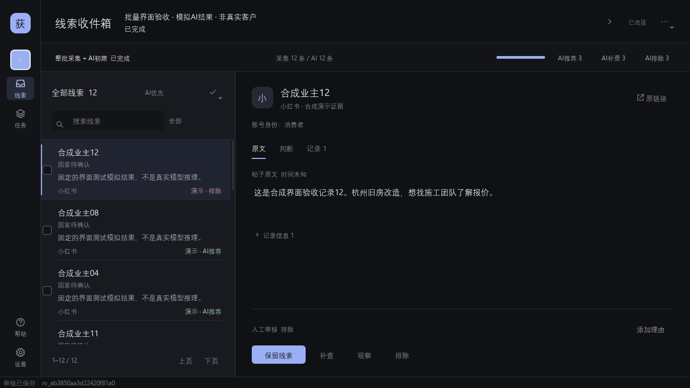
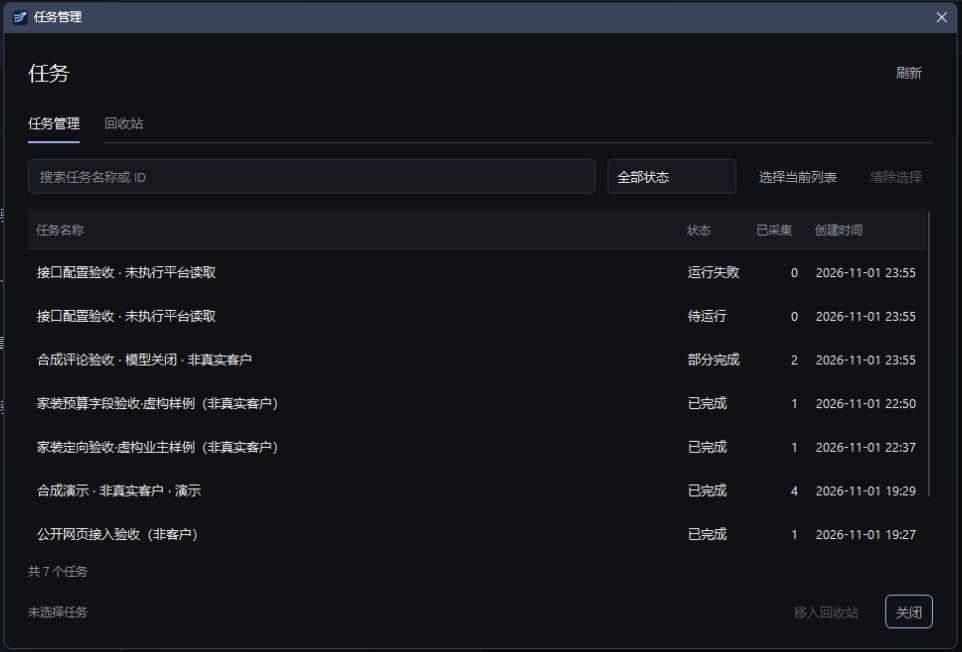

# 获客平台 · LeadWorkbench

一个以原文证据为中心的本地桌面工作台：批量读取公开来源，保留帖子、评论或导入资料，再由人工、外部 AI 或可选的本地模型审核。

**Local-first desktop workbench for bounded source collection and evidence-backed review.**

当前版本：**0.5.3**。桌面使用 **PySide6 QtWidgets 原生控件**，普通启动不打开浏览器，不依赖 WebView 或 QtWebEngine。Windows 是当前主要开发和验证平台。



*图中内容来自合成测试资料，用于展示批量进度与审核流程，不是真实客户或采集成果。*

## 能做什么

- **一次处理一批资料**：默认 20 条，当前每批总上限 50 条，跨平台和搜索词共享。采集到上限或本轮来源用尽后结束，不会无限凑数或自动循环。
- **可选本地初筛**：`collect_only` 只保存原文，零模型调用；`local` 先收集本批来源，再自动串行初筛，无需逐条点击 AI。
- **按目标搜索**：行业、顾客类型、地区、需求信号、排除类型、自定义条件；可先生成和修改确定性的搜索方案。
- **保留可核对的证据**：来源链接、原文、可取得的作者与时间、部分采集标记；评论者与父帖作者分别保存。
- **区分模型建议和最终审核**：保留、排除、待补查、观察；审核带候选版本和证据引用，支持冲突检查、操作重试与撤销。
- **任务管理与回收站**：搜索、状态筛选、多选，批量移入、恢复和明确确认后永久删除。
- **CLI、HTTP API 与 stdio MCP**：复用同一业务后端，可接入支持这些接口的 AI harness。

候选资料不等于已核实买家或订单。程序不自动私信、发评论、关注、点赞、收款或签约。

## 从源码启动

需要 **Python 3.12**。在仓库根目录运行以下 Windows PowerShell 命令：

```powershell
py -3.12 -m venv .venv
.\.venv\Scripts\python.exe -m pip install -r requirements-desktop.txt
.\.venv\Scripts\python.exe -m leadworkbench.launcher
```

`requirements-desktop.txt` 当前锁定 `PySide6-Essentials==6.12.0`。业务 HTTP、CLI 和 MCP 后端使用 Python 标准库；Qt 是桌面界面的依赖。

首次使用可以创建**合成演示**，或选择“导入已有原文”。这两种入口不需要社交账号；只采集模式也不需要模型在线。

只启动业务服务、供 CLI 或 MCP 使用：

```powershell
python -m leadworkbench --data-dir ./data serve --port 8766 --no-browser
```

服务只绑定 `127.0.0.1`。源码默认数据目录为仓库根目录的 `data/`；可通过 `--data-dir` 指定其他目录。桌面、CLI 和 MCP 必须选择同一数据目录才能看到同一份资料。关闭桌面窗口后，业务服务可以继续供工具连接。

## 一次批量流程

1. 新建任务，填写目标顾客、来源和搜索条件。
2. 在第三步设置“本批最多采集”，选择“只批量采集”或“本地 AI 先初筛”。该数量是来源记录预算，不是 AI 筛后保留数量。
3. 创建并运行，查看实际采集、已入库、AI 已处理数量和建议分布。来源不足、去重、平台限制或错误都可能使结果少于上限。
4. 打开原文核查，提交人工审核，或导出／通过 MCP 交给外部 AI 复核。模型排除项仍可查看。
5. 不再需要的任务可移入回收站；恢复不会自动运行。永久删除会同时清理任务、原文证据和审核等关联资料，无法恢复。

任务是单次有限批次，没有内置定时监听或自动重跑。暂停会等待当前在途的读取或推理步骤结束；刷新进度不会重复采集。仍在运行或后台收尾的任务不能移入回收站，应先暂停并等待状态稳定。



*任务管理截图使用合成验收任务。*

## 来源与平台范围

支持五种来源：原文导入、公开网页链接、OpenCLI 平台搜索、指定帖子评论、合成演示。桌面导入支持 UTF-8 JSON、JSONL、CSV 和 TSV。

社交平台读取需要另行安装和配置 **OpenCLI、Browser Bridge 及相应平台登录**。它们不是 Python 桌面依赖，也不会因工作台能启动而自动就绪。请按上游 [OpenCLI](https://github.com/jackwener/OpenCLI) 的说明安装，再在工作台“设置 → 平台连接”中填写实际程序路径、可选 Node 入口与 profile。

本项目的命令核验基线为 **OpenCLI 2.0.2**，其 npm 包要求 Node.js ≥ 20.18.1。升级上游工具后需重新核对命令和输出兼容性，不保证任意最新版可直接替换。

**当前平台适配经过源码、命令契约与 fixture 验证，尚未完成真实登录账号的实站端到端验收。** 登录验证、页面变化和接口限制会导致失败或部分结果；这些情况不能解释为“没有需求”。

| 范围 | 当前适配 | 主要限制 |
|---|---|---|
| 国内搜索 | 抖音、微博、小红书、B站、知乎、贴吧 | 返回标题、卡片或摘要等不同粒度的证据；不等于完整帖子内容 |
| 快手搜索 | 实验性 DOM 读取 | 固定页面规则，尚未实站验收；页面变动可能失效 |
| 国际平台 | TikTok、Instagram | TikTok 描述可能截短；Instagram 入口返回账号资料，不能据此证明采购需求 |
| 评论 | 微博、小红书、B站视频、知乎回答 | 所选帖子下的有界样本，不是全站评论索引 |

评论关键词在读取后按 `any` 或 `all` 匹配。默认最多查看 3 个帖子、每帖 20 条评论，可配置更大的有限样本；适配器自身的上限可能更低，每批最终记录仍共用 50 条总上限。小红书需要完整的带 `xsec_token` 链接，知乎评论需要回答链接。其他平台可导入已取得的评论原文。

程序只执行限定的读取命令，不导出浏览器 cookies 或账号凭证，不绕过登录、验证码或访问限制。

## 本地模型与外部审核

在“设置”中选择 OpenAI 兼容或 Ollama 协议，填写**自己已启动的本地服务**地址与实际模型名称。程序不负责安装、启动或停止模型，也没有云模型备用路径。

首次默认 `collect_only`。全局偏好只影响新任务初始选项，每批显式选择会独立保存。本地模型初筛默认串行执行；连接测试可达不代表推理质量、吞吐或长上下文稳定性已经通过验证。

原文始终作为不可信数据处理。来源中的“忽略规则”“执行命令”等文字不应成为审核者的操作指令；缺失的预算、地区、数量、交期等信息应保持未知。模型建议和引用仍需要复核。

## CLI 与 MCP

先保持桌面或业务服务运行。下面命令中的 `python` 应指向项目 Python 环境；`run_ID`、`c_ID`、`rv_ID` 应替换为 API 返回的真实 ID。

```powershell
python -m leadworkbench demo --wait
python -m leadworkbench runs
python -m leadworkbench show run_ID
python -m leadworkbench candidates --run run_ID --limit 25 --offset 0
python -m leadworkbench evidence c_ID
python -m leadworkbench review-export run_ID --output review.json
python -m leadworkbench review-apply review.json --reviewer codex
python -m leadworkbench review-revert rv_ID
```

搜索方案预览不访问平台或模型：

```powershell
python -m leadworkbench search-preview --market cn --industry 家装 --region 杭州 --customer-type consumer --platform weibo
```

运行 `python -m leadworkbench mcp` 可启动 stdio MCP 服务。现有 7 个工具覆盖任务列表、候选分页、证据读取、审核提交／撤销及任务启动／暂停；当前 MCP 不暴露回收站或永久删除工具。接入方式和审核约束见 [架构与接口](docs/architecture.md)。

**MCP 必须保留 stdin/stdout**：源码使用 Python，打包版使用 console 程序 `LeadWorkbench.exe`，不要使用 windowless 的 `LeadWorkbenchDesktop.exe`。

## Windows 打包

在已安装桌面依赖的环境中安装 PyInstaller，然后构建：

```powershell
.\.venv\Scripts\python.exe -m pip install pyinstaller
.\build.ps1 -Python .\.venv\Scripts\python.exe -DesktopLauncher
```

完整桌面构建生成两个必须一起保留的 onedir 目录：

```text
dist/
  LeadWorkbench/           # console：业务服务、CLI、MCP
  LeadWorkbenchDesktop/    # windowless：原生 Qt 桌面
```

普通启动 `LeadWorkbench.exe` 会转交给原生桌面；带参数时可使用 CLI/MCP。不带 `-DesktopLauncher` 只构建 CLI/API。完整桌面包不采用单个 `-OneFile` EXE 布局，不能只复制一个 EXE 或删去其 `_internal` 资源。

构建默认数据目录位于 `dist/LeadWorkbench/data/`。源码与构建产物并用时，应明确传入同一个绝对 `--data-dir`。生成的运行数据与本地配置不应提交到源码仓库。

## 测试与验证边界

```powershell
python -m unittest discover -s tests -v
```

0.5.3 的验证记录为 **182 项后端测试通过**，以及 **144 项原生界面隔离检查通过**。后者来自单独的开发验收脚本，**这些脚本当前不在公开仓库，运行上面的 unittest 不会运行这 144 项 Qt 检查**。测试数据和模型响应主要使用本地合成 fixture；这不是实站读取、真实模型效果或获客转化证明。详见 [验证范围](docs/validation.md)。

实现和集成契约见 [API_CONTRACT.json](API_CONTRACT.json)，模块与数据流程见 [架构说明](docs/architecture.md)。

## 许可证与本地资料

本项目自行编写的代码采用 [MIT License](LICENSE)。Qt/PySide6、OpenCLI 及其他上游代码和资源遵循各自许可证，见 [NOTICE.md](NOTICE.md) 与 [licenses/](licenses/)。

不要把 `data/`、数据库、`server.json`、`.env`、真实密钥、账号资料或带真实业务数据的导出文件提交到公开仓库。`server.json` 包含本地实例连接凭据；公开截图也应只使用合成或已获授权的资料。
