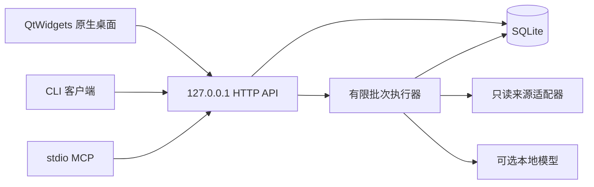

# 架构与接口

LeadWorkbench 0.5.3 使用原生 Qt 桌面和一个本地业务服务。桌面、CLI、MCP 共用同一 HTTP API、SQLite 数据与版本规则。

## 组件关系



桌面不直接修改数据库。业务服务负责资料写入、审核版本、幂等操作、任务生命周期和导出。Qt 网络操作、文件读取与较重解析通过后台执行器完成，结果回到 GUI 线程更新控件。

| 模块 | 职责 |
|---|---|
| `desktop_runtime.py`、`native_window.py` | 原生窗口、同数据目录的实例激活、候选阅读与审核 |
| `native_dialogs.py`、`native_forms.py` | 三步新建任务、设置、审核导入及输入校验 |
| `native_tasks.py` | 任务管理和回收站，通过 API 执行批量生命周期操作 |
| `native_helpers.py`、`native_presenters.py` | 后台执行器、原生主题及列表呈现 |
| `server.py`、`store.py` | 本地 HTTP API、SQLite、版本审核、快照与生命周期事务 |
| `engine.py`、`processing.py` | 有限批次、检查点、处理模式和恢复 |
| `collectors.py`、`comments.py` | 来源规范化、平台能力目录、限定只读命令和评论采样 |
| `targeting.py`、`models.py` | 确定性搜索预览、定向条件及可选模型适配 |
| `cli.py`、`mcp.py` | 通过同一认证 HTTP 客户端提供 CLI 与 stdio MCP |

`static/` 保留兼容的内部 HTTP 界面和资源；普通桌面启动不使用浏览器或 WebView。`certs/` 提供公开网页读取所需的证书资源及其说明。

## 一批任务如何执行

任务创建时保存来源、定向条件、数量预算、评论范围及明确的处理模式。默认 20 条，发布版总上限 50 条，跨平台与搜索词共享；服务通过 `capabilities.max_batch_candidates` 暴露该上限。平台读取器还可能有更低的分页或单次读取预算。

1. 执行器读取有限来源，保存采集检查点。到总上限或本轮读取计划结束即停止，不会自动开启下一轮。
2. `collect_only` 直接保存原文候选，分析状态为 `not_requested`，不调用模型规划或分析。
3. `local` 先完成本批采集，再串行处理记录；模型输出经过结构和原文引用检查后保存。
4. 候选与证据入库，保留实际模型、处理状态、部分内容与截断等信息。完成后可生成不可变快照并导出。

暂停允许当前在途步骤先结束。恢复按检查点继续，并读取当前模型设置；同批可能包含不同实际模型，逐条来源不能被今天的设置覆盖解释。

`Run.batch_summary` 区分已采集、已入库、真实 AI 已处理及各建议数量。模型建议不是人工审核；合成演示和未请求分析也不计为真实推理。搜索、筛选或刷新进度不会重新读取平台。

## 来源证据与审核

来源文本是不可信数据。界面使用纯文本控件显示，不把帖子、评论或导入内容作为命令执行。

评论记录保留评论者、评论原文及父帖上下文。父帖作者不等于评论者，父帖地区或预算不能自动赋给评论者。同一父帖下的评论优先按真实评论 ID 区分；缺少 ID 时使用明确标记的观察内容指纹。没有可核实的评论链接时保留父帖链接，不拼造评论直达地址。

审核只改变判断、理由和标签，不覆盖原始证据。提交审核需要：

- 当前 `candidate_id` 和 `base_version`；
- `keep`、`exclude`、`needs_info` 或 `watch`；
- 审核理由及已有的 `evidence_ids`；
- 独立的 `operation_id`。

同一请求重试使用相同 operation ID 和内容；修改内容后使用新 ID。版本冲突应重新读取候选，而不是强制覆盖。撤销审核同样检查是否存在后续修改。完整字段和错误规则以 [API_CONTRACT.json](../API_CONTRACT.json) 为准。

## 本地连接与数据目录

业务服务只绑定 `127.0.0.1`。客户端每次从选定数据目录的 `server.json` 读取地址和实例 token，不跟随重定向，也不通过代理发送本地业务请求。`server.json` 是运行凭据，不应发布。

所有客户端都应选择同一数据目录。路径优先级为显式 `--data-dir`，其次 `LEADWORKBENCH_HOME`、`LEADWORKBENCH_DATA_DIR`，最后使用默认位置：源码根目录的 `data/`，或 Windows console 分发目录旁的 `data/`。

一个数据目录只使用一个业务服务。关闭 GUI 可以保留服务供 CLI/MCP 使用；程序不会因此启动、停止或修改用户的模型服务。

## 任务管理和回收站

```text
GET  /api/runs?scope=active|trash|all
POST /api/runs/trash
POST /api/runs/restore
POST /api/runs/purge
```

三个写接口均接受：

```json
{
  "run_ids": ["run_ID"],
  "operation_id": "a-unique-operation-id"
}
```

每次处理 1–100 个唯一任务 ID，全部成功或全部拒绝。成功回执包含 `action`、排序后的 `run_ids`、`operation_id`、`changed_count`。

移入回收站添加 `deleted_at`，默认任务列表、读取和执行途径会排除这些任务。运行中、暂停请求中或仍有后台收尾的任务会被拒绝；应先暂停并等待，再刷新重试。

恢复移除删除标记、保留原状态和资料，不自动开始运行。永久删除清理任务及候选、证据、审核、事件和快照等关联资料，无法通过回收站恢复；必要的幂等操作回执仍用于识别同一请求重试。

原生界面核对成功回执后才刷新主窗口。提交失败保留选择和重试 ID；若刷新发现任务已消失或状态变化，会要求核对。写操作在途时暂不允许关闭任务管理窗口，读取请求在途则可以关闭并丢弃旧回调。

## MCP 接入

MCP 是 stdio 进程，仍通过应用 HTTP API 工作。启动前保持业务服务运行，并传入同一数据目录：

```text
python -m leadworkbench --data-dir <absolute-data-directory> mcp
```

宿主配置格式可能不同。以下只示意命令、参数和工作目录；示例路径需替换成自己的绝对路径：

```json
{
  "mcpServers": {
    "leadworkbench": {
      "command": "D:/Projects/leadworkbench/.venv/Scripts/python.exe",
      "args": ["-m", "leadworkbench", "--data-dir", "D:/LeadWorkbenchData", "mcp"],
      "cwd": "D:/Projects/leadworkbench"
    }
  }
}
```

Windows 打包版使用 `LeadWorkbench.exe mcp`，不使用 windowless 桌面 EXE；宿主必须保留 stdin/stdout。

| 工具 | 用途 |
|---|---|
| `runs_list` | 分页列出活动任务 |
| `candidates_list` | 分页读取候选摘要和版本 |
| `evidence_get` | 读取原文、分析与审核历史 |
| `reviews_submit` | 提交原子版本审核 |
| `reviews_revert` | 撤销审核，保留证据 |
| `runs_start` | 启动已有任务 |
| `runs_pause` | 请求暂停 |

当前 MCP 没有任务删除工具。工具调用结束后仍须检查业务结果与 `isError`；外部审核者应分页读取摘要、按需核对原文，并抽查本地模型排除项。

## 构建边界

完整 Windows 桌面构建执行 `build.ps1 -DesktopLauncher`，保留 `dist/LeadWorkbench` 与 `dist/LeadWorkbenchDesktop` 两个完整目录。console 程序承担服务、CLI/MCP，windowless 程序承担 Qt GUI；两者共享指定的数据目录。

PySide6 是桌面依赖，PyInstaller 是构建依赖，OpenCLI／Browser Bridge 是可选平台读取依赖。本地模型由用户自行部署。没有自动下载模型、启动控制器或云模型回退流程。
